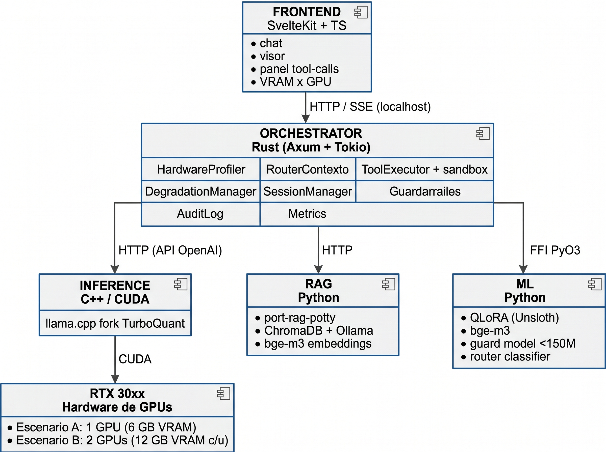

# README.md — Forge30XX

# Forge30XX

Agente de codificación local especializado para GPUs Nvidia serie 30xx. Diseñado para exprimir al máximo hardware de VRAM limitada: RTX 3060 Laptop 6 GB y 2x RTX 3060 12 GB. Sin nube, sin telemetría, sin fuga de código.

Lema: máximo provecho con lo poco disponible.

---

## Tabla de contenido

- [Qué es](#qué-es)
- [Por qué Forge30XX](#por-qué-Forge30XX)
- [Hardware soportado](#hardware-soportado)
- [Arquitectura](#arquitectura)
- [Stack tecnológico](#stack-tecnológico)
- [Instalación](#instalación)
- [Uso rápido](#uso-rápido)
- [Comandos disponibles](#comandos-disponibles)
- [Configuración](#configuración)
- [Perfiles de hardware](#perfiles-de-hardware)
- [Entrenamiento de adaptador LoRA](#entrenamiento-de-adaptador-lora)
- [Testing](#testing)
- [Roadmap](#roadmap)
- [Estructura del repositorio](#estructura-del-repositorio)
- [Contribuir](#contribuir)
- [Decisiones y gobernanza](#decisiones-y-gobernanza)
- [Licencia](#licencia)

---

## Qué es

Forge30XX convierte un modelo abierto (Qwen3.5-4B o Qwen3.6-35B-A3B MoE, ADR-0013) en un agente de codificación autónomo que puede:

- Leer, editar, crear y borrar archivos de tu proyecto.
- Buscar documentación actual en la web (con lista blanca de dominios).
- Ejecutar comandos de shell en sandbox con lista blanca y timeout.
- Consultar un RAG portable para reducir el consumo de tokens.
- Trabajar con contextos de 32K (3060 6 GB) a 64K (2x 3060 12 GB) sin agotar VRAM.

Todo corre en tu máquina. Cero conexiones salientes salvo las búsquedas web explícitas.

---

## Por qué Forge30XX

Los agentes de codificación en la nube son caros, lentos y filtran código propietario. Los intentos locales fallan por tres razones:

1. Los modelos de 7B+ no caben en 6 GB de VRAM.
2. El contexto largo agota la VRAM en pocos turnos.
3. Los agentes no gestionan bien el historial multi-turno.

Forge30XX ataca los tres frentes:

- QLoRA para especializar modelos pequeños en tool-calling.
- TurboQuant para comprimir la caché KV y mantener el contexto completo en VRAM.
- port-rag-potty para reducir el contexto efectivo por consulta.
- Degradación con gracia: nunca falla por OOM, siempre avisa y se adapta.

---

## Hardware soportado

| GPU | VRAM | Perfil | Modelo recomendado | Contexto |
|---|---|---|---|---|
| RTX 3060 Laptop | 6 GB | A | Qwen3.5-4B Q4 | 32K |
| RTX 3060 12 GB (single) | 12 GB | A+ | Qwen2.5-Coder-7B Q4 | 48K |
| 2x RTX 3060 12 GB | 24 GB | B | Qwen3.6-35B-A3B Q4 (MoE) | 64K |
| RTX 3070 / 3070 Ti | 8 GB | A+ | 3B Q5 / 7B Q3 | 40K |
| RTX 3080 10 GB | 10 GB | A+ | 7B Q4 | 48K |
| RTX 3080 Ti / 3090 | 12-24 GB | Premium | 7B Q5 / 14B Q4 | 100K+ |

Requisitos:

- Nvidia serie 30xx (Ampere). Drivers >= 535. CUDA >= 12.1.
- Linux nativo (Ubuntu 22.04+) o Windows 11 con WSL2.
- RAM del sistema: >= 16 GB (Perfil A), >= 32 GB recomendado (Perfil B).
- Docker + nvidia-container-toolkit (recomendado) o compilación nativa.

GPUs AMD, Intel y series 40xx/50xx no están soportadas en v1.0.

---

## Arquitectura




Componentes:

- Orquestador en Rust (Axum + Tokio): concurrencia, latencia predecible, seguridad de memoria.
- Inferencia en C++/CUDA vía llama.cpp fork con TurboQuant.
- Módulos ML en Python (PyO3): QLoRA, embeddings, guard model, router classifier.
- RAG en Python: port-rag-potty sobre ChromaDB + Ollama con bge-m3.
- Frontend en SvelteKit + TypeScript: streaming SSE, CodeMirror 6, uPlot.

---

## Stack tecnológico

| Capa | Tecnología |
|---|---|
| Orquestador | Rust 1.80+, Axum 0.7+, Tokio 1.40+, PyO3 0.22+, rusqlite 0.31+, clap 4.5+ |
| Inferencia | llama.cpp fork `TheTom/llama-cpp-turboquant` (ADR-0004), CUDA 12.1+, CMake 3.28+ |
| ML | Python 3.11+, PyTorch 2.4+, Unsloth, PEFT, bitsandbytes, FlagEmbedding (bge-m3), ChromaDB |
| Frontend | SvelteKit 2.0+, TypeScript 5.5+, TailwindCSS 3.4+, CodeMirror 6, uPlot 1.6+ |
| Infra | Docker + docker compose + nvidia-container-toolkit, GitHub Actions |

---

## Instalación

### Opción 1: Docker (recomendado)

```bash
git clone https://github.com/<tu-usuario>/Forge30XX.git
cd Forge30XX

# Detectar hardware y generar configuración
docker compose run --rm forge doctor

# Levantar el stack
docker compose up -d

# Verificar
docker compose logs -f forge
```

La UI queda disponible en `http://localhost:7860`.

### Opción 2: Compilación nativa

Requiere Rust 1.80+, Python 3.11+, CUDA 12.1+, CMake 3.28+.

```bash
git clone https://github.com/SebasAstrea/Forge30XX.git
cd Forge30XX

# Dependencias del sistema
sudo apt install build-essential cmake pkg-config libssl-dev

# Backend
cargo build --release

# Módulos Python
python -m venv .venv
source .venv/bin/activate
pip install -e python/

# Frontend
cd frontend && npm install && npm run build && cd ..

# Detectar hardware
./target/release/forge doctor

# Ejecutar
./target/release/forge run
```

### Modelos

```bash
# Perfil A: Qwen3.5-4B Q4_K_M (~2.6 GB)
wget -P models/ https://huggingface.co/unsloth/Qwen3.5-4B-GGUF/resolve/main/Qwen3.5-4B-Q4_K_M.gguf

# Perfil B: Qwen3.6-35B-A3B UD-Q4_K_M (~21 GB)
wget -P models/ https://huggingface.co/unsloth/Qwen3.6-35B-A3B-GGUF/resolve/main/Qwen3.6-35B-A3B-UD-Q4_K_M.gguf
```

---

## Uso rápido

```bash
# 1. Detectar hardware y ver recomendación
forge doctor

# 2. Iniciar chat en terminal
forge chat

# 3. Iniciar UI web
forge run --ui

# 4. Consultar el RAG de un proyecto
forge rag query "dónde se define el trait AgentExecutor"

# 5. Entrenar adaptador LoRA para tool-calling
make train-lora PROFILE=A
```

Ejemplo de sesión:

```
$ forge chat

Forge30XX v1.0.0 | Perfil A | RTX 3060 Laptop 6 GB | 32K contexto | turbo2
> lee src/main.rs y dime qué hace la función main
[leer_archivo] src/main.rs (2.4 KB)
La función main inicializa el runtime de Tokio y arranca el servidor Axum...

> añade un endpoint /health que devuelva 200 OK
[edit_file] src/main.rs (+8 líneas)
Aplicado. El endpoint está en la línea 42.
```

---

## Comandos disponibles

```
forge doctor                     Detecta hardware y recomienda configuración
forge run [--ui] [--port N]      Inicia el agente (con o sin UI)
forge chat                       Chat interactivo en terminal
forge train --config FILE        Entrena adaptador LoRA/QLoRA
forge rag <subcomando>           Gestiona el RAG portable
forge model <subcomando>         Descarga y gestiona modelos
forge profile <A|B|auto>         Fuerza un perfil de hardware
forge bench                      Ejecuta benchmarks de rendimiento
forge version                    Muestra versión y build info
```

---

## Configuración

Archivo `forge.config.toml`:

```toml
[hardware]
profile = "auto"           # "A", "B" o "auto"
gpu_index = 0              # GPU principal
kv_split_ratio = 0.6       # Perfil B: fracción de KV en GPU0

[model]
path = "models/qwen2.5-coder-3b-instruct-q4_k_m.gguf"
context_size = 32768
kv_type_k = "turbo2"       # -ctk del llama-server. A: turbo2; B: f16 (ADR-0006)
kv_type_v = "turbo2"       # -ctv del llama-server. A: turbo2; B: turbo3

[inference]
temperature = 0.2
top_p = 0.95
max_tokens = 4096
grammar = "tool_calls.gbnf"

[context_router]
rag_threshold_tokens = 1500   # A: 1500, B: 3000
summarize_at_percent = 70

[security]
guard_input = true
guard_output = true
guard_on_cpu_threshold = 0.90
allowed_domains = ["docs.python.org", "doc.rust-lang.org", "developer.mozilla.org"]

[tools]
workspace = "."
max_file_size_mb = 10
shell_timeout_s = 30
shell_allowlist = ["ls", "cat", "grep", "find", "git", "cargo", "npm", "python"]

[ui]
port = 7860
theme = "dark"
```

Variables de entorno soportadas (prefijo `FORGE_`):

```
FORGE_PROFILE=A
FORGE_MODEL_PATH=/path/to/model.gguf
FORGE_CONTEXT_SIZE=32768
FORGE_UI_PORT=7860
FORGE_LOG_LEVEL=info
```

---

## Perfiles de hardware

### Perfil A: RTX 3060 6 GB Laptop

- Modelo: Qwen3.5-4B Q4_K_M (~2.6 GB).
- KV: TurboQuant `turbo2` (pendiente de medir con Qwen3.5-4B).
- Overhead: ~0.8 GB.
- Total: ~5.7 GB (95% de VRAM).
- Velocidad objetivo: >= 12 tok/s con contexto lleno.

### Perfil B: 2x RTX 3060 12 GB

- Modelo: Qwen3.6-35B-A3B Q4_K_M (~21 GB, MoE con 3B activos) repartido entre las dos GPUs, con los expertos de 2 capas en RAM y sin modo thinking (ADR-0013). Medido: 34.8 tok/s a 64K.
- KV: K `f16` + V `turbo3` (~2.1 GB a 64K, ADR-0006) repartida GPU0/GPU1 midiendo PCIe.
- Total: <= 11.4 GB por GPU.
- Velocidad objetivo: >= 22 tok/s con contexto lleno.
- Enlace PCIe x4 o menor: se mantiene el reparto por capas y `forge doctor` avisa (ADR-0011).

---

## Entrenamiento de adaptador LoRA

```bash
# Perfil A: 3B, QLoRA 4-bit, Unsloth, sin OOM en 6 GB
make train-lora PROFILE=A

# Perfil B: 7B, device_map=auto, 2x 3060
make train-lora PROFILE=B
```

Configuración en `training/lora.yaml`:

```yaml
base_model: Qwen/Qwen2.5-Coder-3B-Instruct
dataset: data/tool_calls_train.jsonl
lora_r: 32
lora_alpha: 64
lora_dropout: 0.05
target_modules: [q_proj, k_proj, v_proj, o_proj]
load_in_4bit: true
gradient_checkpointing: true
optim: paged_adamw_8bit
batch_size: 1
grad_accum: 8
epochs: 3
learning_rate: 2e-4
seed: 42
```

Artefactos generados:

```
artifacts/lora/
  adapter_model.safetensors
  adapter_config.json
  manifest.json    # semilla, datasets, hashes, métricas
```

Merge a GGUF:

```bash
forge model merge --base qwen2.5-coder-3b-q4_k_m.gguf --lora artifacts/lora/ --out merged.gguf
```

---

## Testing

```bash
make check          # fmt + lint + test + coverage
make test-a         # tests Perfil A (3060 6 GB)
make test-b         # tests Perfil B (2x 3060 12 GB)
make bench          # benchmarks de rendimiento
make e2e            # tests E2E Playwright en A y B
```

Umbrales bloqueantes:

- Cobertura >= 80% core, >= 60% integración.
- Cero warnings de `clippy -D warnings` y `ruff check`.
- Regresión > 5% en tok/s o > 10% en latencia p95 bloquea merge.
- Tool-calls JSON válidas: >= 90% (A), >= 95% (B).
- Guardarraíl: >= 90% (A) / >= 95% (B) detección, < 8% / < 5% falsos positivos.

---

## Roadmap

### v1.0 (actual)

- Detección de hardware y perfiles A/B.
- Inferencia con TurboQuant (caché KV cuantizada).
- QLoRA para tool-calling.
- Tool-calls: leer, editar, crear, borrar, buscar web, shell sandbox, RAG.
- UI web + CLI.
- Guardarraíles de entrada/salida + audit log.

### v1.1 (próximo)

- Merge LoRA + GGUF con validación automática.
- Resumen de historial con LLM-juez.
- Persistencia de sesión entre reinicios.

### v2.0 (futuro)

- Soporte experimental para RTX 40xx.
- Multimodalidad (imágenes en el contexto).
- Múltiples adaptadores LoRA intercambiables en caliente.
- Modo multi-proyecto.

Fuera de alcance: AMD, Intel, nube, multi-tenant, NVLink.

---

## Estructura del repositorio

```
Forge30XX/
  orchestrator/          # Rust: Axum, Tokio, router, tool executor
  inference/             # C++/CUDA: llama.cpp fork, kernels
  python/
    forge_ml/            # QLoRA, embeddings, guard model, router classifier
    forge_rag/           # port-rag-potty adaptado
  frontend/              # SvelteKit + TypeScript
  training/              # Configs de entrenamiento
  models/                # GGUF (gitignored)
  artifacts/             # LoRA outputs (gitignored)
  docs/
    SDD.md               # Spec-Driven Development
    adr/                 # Architecture Decision Records
    openapi.yaml         # API spec
  tests/
    integration/
    e2e/
  docker/
  Makefile
  forge.config.toml
  AGENTS.md              # Reglas para agentes codificantes
  SDD.md                 # Spec-Driven Development
  CHANGELOG.md
  LICENSE
```

---

## Contribuir

1. Lee `docs/SDD.md` y `AGENTS.md` antes de tocar código.
2. Abre un issue con el RF o HU asociado.
3. Crea rama `feat/RF-XX-descripcion` o `fix/descripcion`.
4. Sigue TDD: test que falla, código mínimo, refactor.
5. Ejecuta `make check` y `make bench` antes de commit.
6. Abre PR con la plantilla. Un revisor humano + agente revisor automático.
7. Conventional Commits obligatorio.

Reglas clave:

- SOLID, DRY, KISS, YAGNI.
- Funciones <= 40 líneas, archivos <= 400 líneas.
- Sin `unwrap()` en Rust fuera de tests.
- Sin `print()` en Python.
- Sin `any` en TypeScript.
- Sin dependencias nuevas sin ADR aprobada por el PO.

---

## Decisiones y gobernanza

Product Owner: **Sebastia M.** Sobre él recae la decisión final sobre cualquier cambio que altere el rumbo del MVP.

Requieren consulta obligatoria al PO (bloquean la tarea hasta respuesta):

- Cambios de arquitectura o ADRs existentes.
- Cambios de stack tecnológico.
- Añadir, eliminar o modificar RF/RNF o umbrales de KPI.
- Crear, eliminar, repriorizar o reestimar HUs.
- Cambios de alcance del MVP.
- Cambios de metodología o DoD.

Procedimiento:

1. Detener la tarea afectada.
2. Formular pregunta estructurada al PO: contexto, opciones (mínimo 2), trade-offs, recomendación, impacto.
3. Registrar issue con label `decision:po`.
4. Esperar respuesta antes de continuar.
5. Documentar como ADR y reflejar en SDD y backlog.

Detalle completo en `AGENTS.md` sección 11.0 y `docs/SDD.md` sección 0.

---

## Licencia

MIT. Ver `LICENSE`.

Uso personal y comercial permitido. Sin garantías. El autor no se responsabiliza por el uso que se dé al agente ni por las acciones que ejecute sobre tus archivos.

---

## Agradecimientos

- [llama.cpp](https://github.com/ggerganov/llama.cpp) y el fork [TurboQuant](https://github.com/TheTom/llama-cpp-turboquant).
- [Qwen](https://github.com/QwenLM) por los modelos base (Qwen3.5 y Qwen3.6, Apache-2.0).
- [Unsloth](https://github.com/unslothai/unsloth) por acelerar QLoRA.
- [Glaive function-calling v2](https://huggingface.co/datasets/glaiveai/glaive-function-calling-v2) (Apache-2.0), parte pública del dataset de tool-calling (ADR-0012).
- [port-rag-potty](https://github.com/SebasAstrea/port-rag-potty) a mí mismo por el RAG portable XD.
- La comunidad de RTX 30xx que sigue exprimiendo hardware "obsoleto".

---

Hecho con la convicción de que el hardware que ya tienes merece mejor software.
